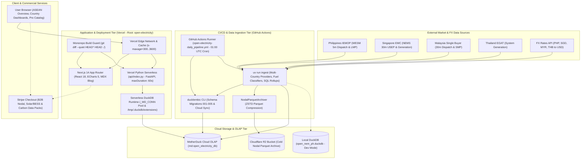

# OpenNEM Philippines (OpenElectricity PH)

An open-source electricity market tracker and power system analytics platform for the **Philippines Wholesale Electricity Spot Market (WESM)**, inspired by [OpenNEM / OpenElectricity Australia](https://explore.openelectricity.org.au/).


---

## ⚡ Overview

OpenNEM-PH tracks the electricity transition in the Philippines by ingesting and visualizing official market and dispatch data published by **IEMOP (Independent Electricity Market Operator of the Philippines)**:

- 📊 **Generation Fuel Mix**: 5-minute and hourly interval stacked area charts across **Solar**, **Wind**, **Hydro**, **Geothermal**, **Biomass**, **Natural Gas**, **Black Coal**, **Oil / Diesel**, and **Battery Storage (BESS)**.
- 📈 **Wholesale Spot Prices**: 5-minute Locational Marginal Prices (LMP) and Market Clearing Prices across the grid.
- ⚡ **Macro Grid Demand & Losses**: Real-time system load, transmission losses, and net flows.
- 🔌 **Interconnector Flows**: Physical transfers across the **Luzon–Visayas HVDC** and **Mindanao–Visayas Interconnection Project (MVIP)** submarine links.
- 🌿 **Emissions & Renewables Tracking**: Carbon intensity (gCO₂/kWh) and renewable energy penetration percentage.
- 🏝️ **Regional Breakdown**: Philippines Total (NEM), Luzon, Visayas, and Mindanao grids.

---

## 🏗️ Architecture

### System & Deployment Architecture



### Deployment Components

| Component | Platform / Runtime | Source Path | Role & Deployment Invariants |
| :--- | :--- | :--- | :--- |
| **Frontend Web App & Blog** | Vercel Edge CDN / Next.js 14 App Router | `src/app/`, `src/components/`, `src/content/blog/` | Static MDX blog generation and interactive SPA telemetry dashboard with Apache ECharts 5, dynamic region switching, and responsive waffle charts. |
| **Analytical API Backend** | Vercel Python Serverless Function | `api/index.py`, `vercel.json` | High-performance FastAPI analytical gateway with `maxDuration: 60s`. Enforces `/tmp/.duckdb/extensions` directory invariant, thread-safe `_MD_CONN` connection pool reuse, and tiered `Cache-Control` (`s-maxage=300..3600`). |
| **Monorepo Build Filter** | Vercel Build System | `vercel.json` | Enforces `ignoreCommand: "git diff --quiet HEAD^ HEAD ./"` to prevent cascading builds across unrelated monorepo projects (`nem-battery`, `pollmph`, `krillion`). |
| **Cloud OLAP Database** | MotherDuck Serverless DuckDB | `md:open_electricity_db`, `migrations/001..005` | Primary analytical data warehouse managed via Ducklembic. Stores normalized tables: `facilities`, `energy_interval`, `prices_interval`, `energy_daily`, `prices_daily`, and `exchange_rates`. |
| **Cold Nodal Archive** | Cloudflare R2 (S3-Compatible Object Storage) | `packages/pipeline/pipeline/archiver.py` | Idempotent long-term archive for raw 5-minute locational marginal price (LMP) and dispatch records. Compressed with ZSTD into daily Parquet partitions (`data/archive/<COUNTRY>/<YEAR>/`). |
| **Scheduled ETL & Migrations** | GitHub Actions (Ubuntu Runner + `uv` / Python 3.12) | `.github/workflows/open-electricity-daily_pipeline.yml` | Automated daily ingestion (`01:00 UTC` cron / `workflow_dispatch`). Applies Ducklembic migrations, pulls external market data, executes multi-country providers, and respects `motherduck-ingest` concurrency lock. |
| **Commercial Checkout** | Stripe Hosted Checkout | `src/components/ProDataBanner.tsx`, `/api/pro/catalog` | Self-service B2B data licensing and export catalog for nodal dispatch series, Solar/BESS co-location analytics, and high-resolution carbon accounting datasets. |

### Repository Structure

```
open-electricity/
├── .github/
│   └── workflows/
│       └── open-electricity-daily_pipeline.yml # Monorepo CI/CD daily ETL cron (01:00 UTC)
├── api/
│   ├── index.py                                # FastAPI Serverless API (Vercel maxDuration: 60s)
│   ├── pyproject.toml                          # Serverless backend dependencies
│   └── tests/                                  # API unit tests (uv run pytest)
├── docs/                                       # Publishing & technical guides
├── migrations/                                 # Ducklembic versioned SQL migrations (001-005)
│   ├── 001_initial_schema.up.sql
│   ├── 002_tiered_data_model.up.sql
│   ├── 003_lean_data_model.up.sql
│   ├── 004_separate_price_tables.up.sql
│   └── 005_capture_price_and_lwap.up.sql
├── packages/
│   ├── ducklembic/                             # Reusable DuckDB + MotherDuck migration library
│   │   ├── ducklembic/                         # Migration runner, state tracker & cloud sync
│   │   └── pyproject.toml
│   └── pipeline/                               # Multi-country ETL & ingestion engine (uv)
│       ├── pyproject.toml                      # Ingestion CLI entry points
│       └── pipeline/
│           ├── archiver.py                     # NodalParquetArchiver (ZSTD cold storage)
│           ├── classifiers/                    # Fuel technology & plant classifier models
│           ├── db.py                           # DuckDB & MotherDuck database operations
│           ├── ingest.py / cli.py              # Ingestion CLI commands & dispatch loops
│           └── providers/                      # Country market data extractors
│               ├── base.py                     # BaseProvider interface
│               ├── my_singlebuyer.py           # Malaysia Single Buyer (30m SMP & mix)
│               ├── ph_iemop.py                 # Philippines IEMOP (5m WESM dispatch)
│               ├── sg_emc.py                   # Singapore EMC (30m USEP & generation)
│               └── th_egat.py                  # Thailand EGAT (System hourly generation)
├── src/                                        # Next.js 14 Frontend Application
│   ├── app/                                    # App Router (ASEAN overview, country routes, blog)
│   ├── components/                             # ECharts visualizations, waffle charts, Pro banner
│   ├── content/blog/                           # MDX analytical articles & market reports
│   └── lib/                                    # Types, API client, color maps & formatters
├── open_nem_ph.duckdb                          # Local DuckDB database (embedded development mode)
├── vercel.json                                 # Vercel deployment routing & monorepo build guard
├── package.json                                # Frontend dependencies & workspace scripts
└── pyproject.toml                              # Root Python project configuration
```

---

## 🚀 Quick Start

### 1. Ingestion Pipeline (`uv`)

We use [`uv`](https://docs.astral.sh/uv/) for Python package management:

```bash
# Sync dependencies
uv sync

# Run daily sync (fetches latest market data)
uv run ingest latest

# Run historical backfill for custom date range
uv run ingest backfill --start-date 2026-08-01 --end-date 2026-08-31

# Sync local DuckDB data to MotherDuck Cloud
uv run ingest sync-cloud

# Inspect database tables, row counts, and data samples
uv run ingest inspect
uv run ingest inspect --table dispatch --region LUZON --limit 10
uv run ingest inspect --table facilities --limit 10
uv run ingest inspect --table regional --limit 10
uv run ingest inspect --table daily --limit 10
```

> **Note**: For local development, the backend automatically connects to `open_nem_ph.duckdb`. When `MOTHERDUCK_TOKEN` is configured in `.env`, it seamlessly connects to MotherDuck Cloud (`md:open_electricity_db`).

---

### 2. Running Locally (FastAPI + Next.js)

**Single Command (Recommended)**:
```bash
./dev.sh
# or
npm run dev:all
```
This starts both the FastAPI backend (`:8000`) and Next.js frontend (`:3000`) concurrently and handles graceful shutdown when pressing `Ctrl+C`.

Alternatively, run them in separate terminals:

**Terminal 1: FastAPI Backend**
```bash
# Start the Python FastAPI server on port 8000
uv run uvicorn api.index:app --port 8000 --reload
```
Interactive API documentation will be available at [`http://localhost:8000/api/docs`](http://localhost:8000/api/docs).

**Terminal 2: Next.js Frontend**
```bash
# Install frontend dependencies
npm install

# Start Next.js dev server on port 3000 (proxies /api requests to FastAPI)
npm run dev
```

Visit [`http://localhost:3000`](http://localhost:3000) to view the live dashboard!

---

## 🗄️ Database Setup (DuckDB & MotherDuck)

- **Local Development**: Runs out of the box using embedded [DuckDB](https://duckdb.org/) (`open_nem_ph.duckdb`). No database server installation required.
- **Cloud Deployment (MotherDuck)**:
  1. Create a database token on [MotherDuck](https://motherduck.com/).
  2. Set your environment variable in `.env` (and Vercel / GitHub Actions secrets):
     ```env
     MOTHERDUCK_TOKEN=your-motherduck-token-here
     MOTHERDUCK_DATABASE=open_electricity_db
     ```
  3. Run `uv run ducklembic sync push --yes` to sync your local DuckDB data directly to MotherDuck Cloud!

---

## 🤖 Daily Automated Pipeline (GitHub Actions)

The repository includes a production-ready GitHub Action in [`.github/workflows/open-electricity-daily_pipeline.yml`](../.github/workflows/open-electricity-daily_pipeline.yml):
- **Schedule**: Automatically runs daily at `01:00 UTC` (`09:00 AM UTC+8` Manila / Singapore / Kuala Lumpur), right after regional markets finalize interval data.
- **Multi-Country Coverage**: Synchronizes generation mix, fuel technology categorization, and spot prices across Philippines (IEMOP), Singapore (EMC), and Malaysia (Single Buyer).
- **MotherDuck Ingestion**: Automatically writes and rolls up data in MotherDuck Cloud using the `MOTHERDUCK_TOKEN` secret.
- **Automated Schema Evolution**: Runs Ducklembic migrations prior to ingestion so the cloud database schema is always in sync.
- **Manual Trigger**: Can be manually triggered on demand (`workflow_dispatch`) with custom parameters:
  - `mode`: `latest`, `backfill`, `sync-facilities`, `migrate`, or `inspect`.
  - `country`: `ALL`, `PH`, `SG`, or `MY`.
  - `days` or custom `start_date` / `end_date` ranges.
- **Secrets Needed**: Add `MOTHERDUCK_TOKEN` under **Settings > Secrets and variables > Actions** in your GitHub repository.

---

## 🌐 Deploy to Vercel

1. Import this repository into [Vercel](https://vercel.com).
2. **Settings**:
   - **Framework Preset**: `Next.js` (detected automatically)
   - **Root Directory**: `./` (leave default)
   - **Build Command** & **Output Directory**: Leave default (no custom commands needed)
3. **Environment Variables** (under **Settings → Environment Variables**):
   - `MOTHERDUCK_TOKEN`: Your MotherDuck Service Token
   - `MOTHERDUCK_DATABASE`: `open_electricity_db`
4. Deploy! Vercel will automatically build the Next.js React frontend and deploy the FastAPI serverless function at `/api/*`.

---

## 📄 License & Data Attribution

- Inspired by the [OpenNEM project](https://explore.openelectricity.org.au/).
- Philippine market data provided by [IEMOP (Independent Electricity Market Operator of the Philippines)](https://www.iemop.ph/).
- Open source under the MIT License.

